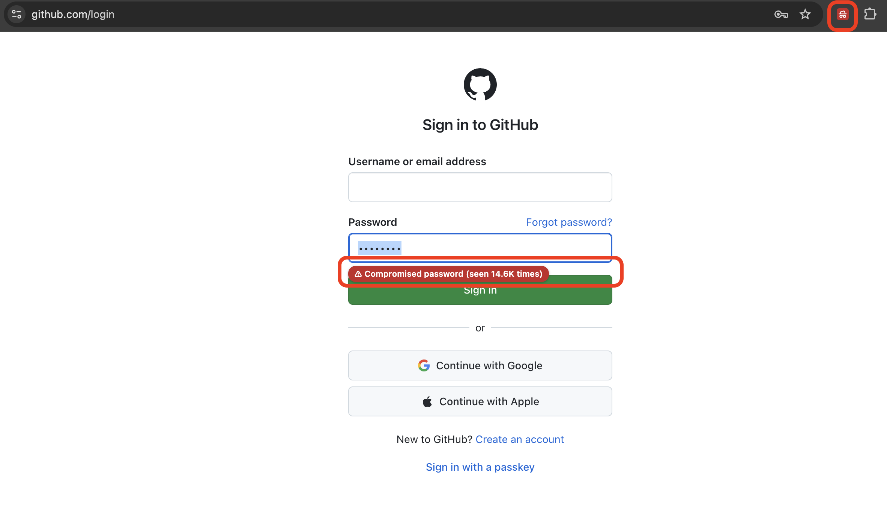
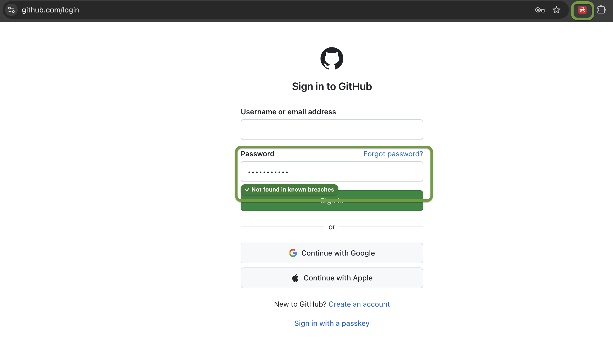

<p align="center">
  
</p>

<h1 align="center">Am I Pwned?</h1>

A Chrome extension that tells you, **as soon as you enter a password**, whether it has appeared in a known data breach. It never sends the password anywhere.

It uses the [Pwned Passwords](https://haveibeenpwned.com/Passwords) service from [Have I Been Pwned](https://haveibeenpwned.com/), and follows the approach of Symfony's [`NotCompromisedPasswordValidator`](https://github.com/symfony/symfony/blob/8.1/src/Symfony/Component/Validator/Constraints/NotCompromisedPasswordValidator.php).

---

## What it does

### On any web page

The extension watches every password field (`<input type="password">`) on every site: login forms, sign-up forms, "change password" pages.

1. Type a password (at least **5 characters**).
2. When you **leave the field** (or press Enter), the extension checks the **whole value**, once.
3. A small badge appears under the field:

| Badge | Meaning |
|---|---|
| **Checking…** (grey) | Check in progress |
| ⚠ **Compromised password (seen 3.7M times)** (red) | The password was found in breaches; the number says how many times. Hover for the exact count. |
| ✓ **Not found in known breaches** (green) | Not found in any known breach |
| **Check unavailable** (orange) | The service could not be reached |

Nothing is checked *while* you type: editing the value hides the badge until you leave the field again (see [why](#why-not-check-on-every-keystroke)). It also works on fields added after the page loads (single-page apps), inside iframes, and inside open shadow DOM.

### Example

| Compromised password | Password not found in breaches |
|---|---|
|  |  |

---

## How your password stays private

The extension uses the **k-anonymity** model of the Pwned Passwords range API:

```
   your browser tab                         extension background         api.pwnedpasswords.com
 ┌────────────────────────┐               ┌──────────────────┐         ┌─────────────────────┐
 │ "password"             │               │                  │         │                     │
 │   │ SHA-1 (local)      │   "5BAA6"     │                  │  GET    │ returns ~800–1000   │
 │   ▼                    │ ────────────► │ HIBP client      │ ──────► │ hash suffixes that  │
 │ 5BAA6 1E4C9B93F3F06…   │               │                  │ /range/ │ start with 5BAA6,   │
 │ └prefix┘└─ suffix ──┘  │ ◄──────────── │                  │ ◄────── │ with their counts   │
 │ suffix compared locally│   all suffixes│                  │  5BAA6  │                     │
 └────────────────────────┘               └──────────────────┘         └─────────────────────┘
```

1. The password is hashed with **SHA-1 inside the page**.
2. Only the **first 5 hex characters** of the hash leave the page. Hundreds of thousands of different passwords share any given 5-character prefix.
3. HIBP returns every known hash suffix for that prefix. The extension looks for yours **locally**.
4. Each request includes the `Add-Padding: true` header. HIBP then adds fake entries so the response size gives nothing away. The extension drops those entries (their count is 0).

So the password, or even its full hash, never leaves the page. Not to HIBP, and not to the rest of the extension.

### Why not check on every keystroke?

k-anonymity only protects a password if its prefix is sent **once**. Checking as you type would send the prefix of `passw`, then `passwo`, then `passwor`… Anyone who sees those requests (HIBP, its CDN, a TLS-inspecting proxy) could then rebuild the password offline: about 7,000 five-character strings match the first prefix, and each extra prefix pins down the next character almost uniquely. That is why the extension checks only the value you commit.

---

## Services and technologies used

| What | Used for |
|---|---|
| [**Have I Been Pwned – Pwned Passwords API**](https://haveibeenpwned.com/API/v3#SearchingPwnedPasswordsByRange) (`https://api.pwnedpasswords.com/range/{prefix}`) | Source of breached password hashes. Free, **no API key**, k-anonymity range queries. |
| **Chrome Extension, Manifest V3** | Content script (runs on pages), background service worker (network calls) |
| **Web Crypto API** (`crypto.subtle`) | SHA-1 hashing, locally in the browser |
| **TypeScript** | Whole codebase, `strict` mode |
| **Vite** | Build (background as an ES module, content script as an IIFE) |
| **Vitest + jsdom** | Unit tests |

---

## Install from a release (until it is on the Chrome Web Store)

1. Download `ami-pwned-<version>.zip` from the [latest release](https://github.com/ismail1432/amipwned/releases/latest).
2. Unzip it into a folder you will keep. Chrome loads the extension from that folder, so don't move or delete it.
3. Open `chrome://extensions`, turn on **Developer mode**, click **Load unpacked**, and select the unzipped folder.

Extensions loaded this way **don't update automatically**: repeat the steps with each new release. The zip is built and attached by CI from the tagged source (see [`release.yml`](./.github/workflows/release.yml)); it is never committed to the repository.

## Install (development build)

Requires **Node.js ≥ 20**.

```bash
npm install
npm run build        # outputs the unpacked extension to dist/
```

Then in Chrome (or any Chromium browser: Edge, Brave, Arc):

1. Open `chrome://extensions`.
2. Turn on **Developer mode** (top right).
3. Click **Load unpacked** and select the `dist/` folder.

On install, Chrome warns that the extension can *"read and change all your data on all websites"*. It needs this to watch password fields on every site. It only reacts to password fields.

### Try it

- Open https://github.com/login, type `password` in the password field, then click outside it. You should see the red badge.
- Type a few random characters more (the badge disappears), then leave the field again. The badge should turn green.
- To check what leaves the page: on `chrome://extensions`, click the extension's **service worker** link and open the **Network** tab. You'll only see `range/XXXXX` requests.

### While developing

```bash
npm run dev          # rebuilds dist/ on every change
```

After a rebuild, click ↻ on the extension card, then **reload any open tabs**. Tabs that were already open keep running the old content script.

---

## Scripts

| Command | Description |
|---|---|
| `npm run build` | Clean, type-check, and build the extension into `dist/` |
| `npm run package` | Build, then zip `dist/` into `release/ami-pwned-<version>.zip` (Store upload format) |
| `npm run icons` | Regenerate `public/icons/*.png` from `assets/icon.svg` |
| `npm run dev` | Rebuild on every change (watch mode) |
| `npm test` | Run all unit tests (no network) |
| `npm run test:contract` | Run the tests that call the **real** HIBP API |
| `npm run typecheck` | Type-check only |

---

## Architecture

The code follows a **hexagonal architecture** (ports and adapters). The core logic has no knowledge of the browser or the network.

```
src/
├── domain/              Core logic, no dependencies
│   ├── CheckPasswordCompromise.ts   use case: empty → skip; SHA-1; fetch range; any occurrence → compromised
│   └── ports/                       PasswordHasher, BreachedPasswordRegistry, CheckPassword
├── infrastructure/      Adapters
│   ├── WebCryptoSha1Hasher.ts       SHA-1 via Web Crypto
│   ├── HibpRangeClient.ts           HTTP client for the HIBP range API
│   ├── messaging/                   content script ⇄ background bridge (sends only the prefix)
│   └── container.ts                 wiring of adapters into the use case
├── content/             Content script: field detection, check on commit, badge
└── background/          Service worker: makes the HIBP calls
```

A password counts as compromised as soon as it appears once in a breach. If HIBP can't be reached, the check fails and the badge says so. Like Symfony's validator, the HIBP client takes a **configurable endpoint**, for a self-hosted mirror of the Pwned Passwords data.

See [`CLAUDE.md`](./CLAUDE.md) for the detailed rules (invariants, build quirks, test conventions).

---

## Limitations

- **HTTPS only**: the content script only runs on `https://` pages. Browsers only provide Web Crypto on secure pages, and the extension won't send the password out of the page to hash it, so it does nothing on plain `http://` pages (including `http://localhost`).
- **Closed shadow DOM**: password fields inside *closed* shadow roots can't be detected.
- **Chromium only** for now. Firefox would need small manifest changes.

---

## Credits

- Breach data: [Have I Been Pwned](https://haveibeenpwned.com/) by Troy Hunt. Pwned Passwords data is published under [CC BY 4.0](https://creativecommons.org/licenses/by/4.0/).
- Design inspired by Symfony's [`NotCompromisedPasswordValidator`](https://github.com/symfony/symfony/blob/8.1/src/Symfony/Component/Validator/Constraints/NotCompromisedPasswordValidator.php).
